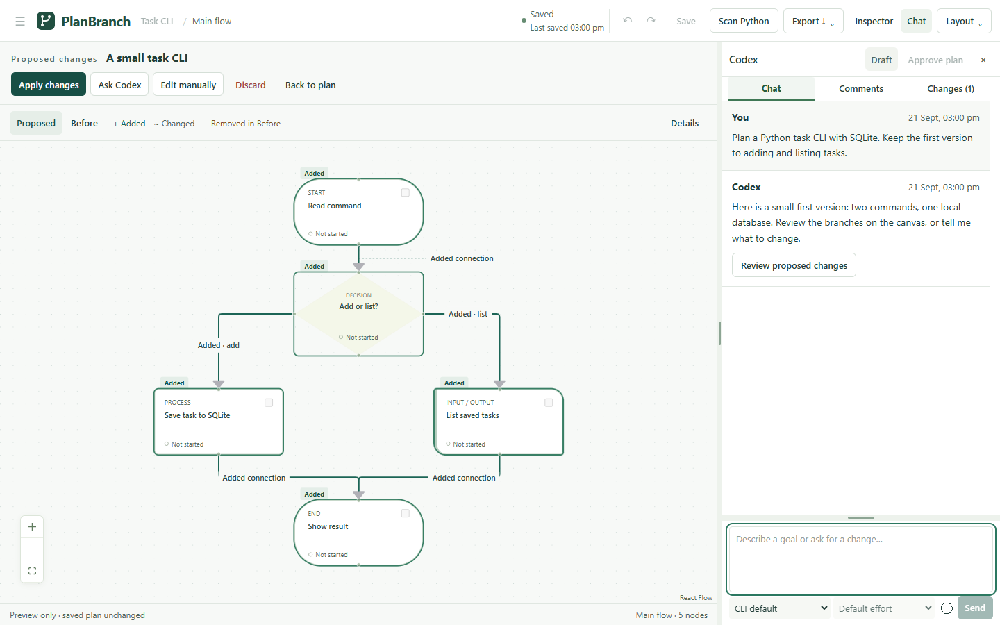
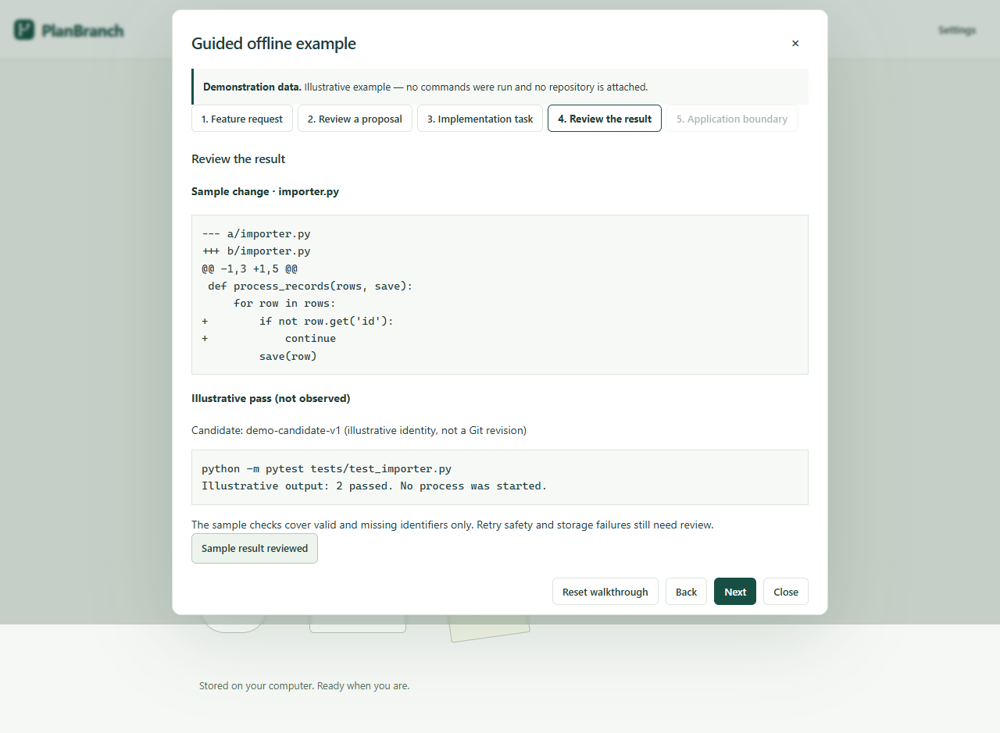

# PlanBranch

**A visual workspace for directing and reviewing coding agents.**

Connect what you intended → what you approved → what an agent changed → what was checked → what you applied. Discuss a coding goal beside an editable diagram, preserve alternative designs, and build one selected task in an isolated Git worktree or your existing editor.

**[Downloads and release status](https://github.com/AdrianIp0204/PlanBranch/releases/latest)** · [Offline quick start](#try-it-offline) · [Current roadmap and validation gates](docs/Product_Roadmap.md)

Published packages appear on the Releases page. A CI artifact or draft release is a prepared build, not a public release. Source installation remains available below.

[](https://github.com/AdrianIp0204/PlanBranch/actions/workflows/checks.yml)
[](LICENSE)


*The working app with disposable sample data and a deterministic example conversation.*

## From an idea to a reviewed change

1. **Describe the goal.** Keep requirements, constraints, decisions and assumptions in the project brief. Answer the agent's clarification cards with a choice or your own words.
2. **Review the plan visually.** Compare Before and Proposed, visit each changed item, edit the candidate or ask for a revision. Proposal drafts recover after restart.
3. **Apply and approve.** Apply a proposal as one undoable edit. Approve the saved plan when it reflects your intent.
4. **Define implementation work.** Use Build tasks for deliverables, expected files, acceptance checks and prerequisites. Diagram connections describe program behaviour and may loop; task prerequisites must be acyclic.
5. **Run one step explicitly.** Select an execution repository and review the task, source revision and model settings before Run. Inspect its diff and observed command results, then separately accept changes, complete the task and apply to your checkout.

**Plan approval never authorizes code execution.** There is no autonomous full-plan execution, automatic merge, commit or push. Each run starts from a committed revision; review and commit applied work yourself before running a dependent task.

| Workspace | What it provides |
| --- | --- |
| Diagram | Branches, merges, loops, notes, checklists, blockers and implementation targets. Tidy previews horizontal or vertical arrangements with pins and single-action Undo. |
| Chat and review | Ollama, OpenAI, Anthropic, Gemini or Codex CLI; independent planning/coding defaults, node comments, structured questions, durable drafts and navigable review hints. |
| Brief and Build | Persistent requirements and separate implementation tasks, including explicit review of agent-proposed edits. |
| Plan versus code | Human-authored variables kept separate from read-only Python evidence. Confirm links yourself; scans do not mark work complete. |
| Local storage | Multiple projects and diagrams, autosave, restart-safe Undo/Redo, SQLite backups, JSON/Markdown sharing and full-diagram PNG. |

## Try it offline

1. Install a portable package or wheel using the instructions below and open **[127.0.0.1:4310](http://127.0.0.1:4310)**.
2. Choose **Guided offline example**. Review a feature brief, select a proposed design, inspect criteria and a sample diff, and record a sample review. The sample diff illustrates validation only; counting saved records remains a separate dependent task. All check output is explicitly illustrative; no command runs.
3. Choose **Open example project** to explore its real diagram and two dependent Build tasks. The example has no repository attachment, approval, execution grant or test results. **Reset walkthrough** only resets the walkthrough; loading an example always creates a separate project.
4. Open **Setup capabilities** (also in the **Project** menu) when you want AI planning, code editing or isolated checks. Visual planning needs no account, API key or command runtime. Checks are retryable; nothing installs dependencies automatically.



## Windows portable package

Extract the **PlanBranch 0.3.1 Windows x64** ZIP from a published release (or a clearly identified CI artifact) to a new ordinary folder and run `planbranch.cmd`. Open **[127.0.0.1:4310](http://127.0.0.1:4310)**. The package contains Python and the built interface; Node, a Python installation and a frontend build are unnecessary. `flowdesk.cmd` remains a compatible alias. Release artifacts include SHA-256 checksums and their source commit.

The first screen shows the selected provider’s connection status. **New project** and **Load example** remain usable without a model connection. Cloud connections require an explicit metadata check; key presence alone is not a verified connection. Reopen the check through **Layout → Provider connection**. Setup links do not install anything automatically.

Portable artifacts are built locally with `scripts/build_windows_portable.py`; CI is configured to generate them on Windows. This repository also supports source and wheel installations below.

Choose **Settings → Agent** to use local Ollama, OpenAI API, Anthropic API, Gemini API, or the optional Codex CLI. Planning and Coding have separate defaults. API credentials stay in the backend environment; Codex sign-in does not supply API access or billing. Existing requests and retries retain their original provider and settings.

Native-provider coding uses the existing one-task review workflow and a shared bounded tool loop. Commands require a separately installed local Docker engine and an explicitly selected, already prepared image. Without that runtime, constrained file editing remains available and checks are marked not run. Codex retains its separate executor. Nothing installs dependencies, enables network access, accepts changes or applies code automatically.

See [model setup and coding boundaries](docs/Providers.md) for credentials, local/cloud destinations, supported runtime requirements and recovery.

## Source or wheel installation

Building from source requires **Python 3.14** and **Node 24**:

```sh
git clone https://github.com/AdrianIp0204/PlanBranch.git
cd PlanBranch
```

<details>
<summary><strong>Windows · PowerShell</strong></summary>

```powershell
python -m venv .venv
.\.venv\Scripts\python.exe -m pip install -r requirements.lock
npm ci --prefix frontend
npm run build --prefix frontend
.\.venv\Scripts\python.exe -m flowdesk
```

</details>

<details>
<summary><strong>Linux</strong></summary>

```sh
python3.14 -m venv .venv
.venv/bin/python -m pip install -r requirements.lock
npm ci --prefix frontend
npm run build --prefix frontend
.venv/bin/python -m flowdesk
```

</details>

For an already-built wheel, run `python -m pip install flowdesk-0.3.1-py3-none-any.whl` in a Python 3.14 environment, then run `planbranch`, `flowdesk` or `python -m flowdesk`. Pip needs the declared dependencies locally or permission to download them. Node and the source checkout are unnecessary. The distribution and module retain the `flowdesk` name for compatibility.

The editor, scanner and exports work offline. Dependency downloads and optional cloud requests need internet access. The Python launcher serves both the interface and API; a separate frontend server is unnecessary.

## Make the workspace yours

For a real project, write its brief and tasks, then approve the design. **Build** shows each task's next action, approval freshness and blockers. Intent approval, Run authorization, result acceptance, task completion, checkout Apply and your Git commit remain separate. Completing a prerequisite or moving a diagram node does not invalidate unchanged intent; changed scope, criteria or relevant diagram meaning does. Source and runtime policies are checked again at execution and application boundaries.

Expand **Requirement, code and acceptance evidence** in a task or its linked diagram node to inspect candidate-bound files, checks and human review. The brief's requirements paragraph is one stable requirement record; acceptance criteria retain their IDs when edited, but changed meaning makes old review stale. Process success alone is not proof that tests ran or that a whole requirement is satisfied. See [workflow and evidence](docs/WORKFLOW_EVIDENCE.md) and [repository-context consent](docs/Repository_Context.md).

Use **Project → Checkpoints and alternatives** to preserve, duplicate, compare, select and restore designs. Alternatives are logical plans, separate from Git branches. Restore saves a recovery point and requires fresh approval. To implement elsewhere, expand **Use an external coding agent** in a Build task, preview/copy its brief and later import its local commit reference for review. See [checkpoint and handoff workflows](docs/CHECKPOINTS_AND_HANDOFF.md).

The compact header keeps Diagram/Build, panel toggles, search and settings together. **Project** groups the brief, save, scan, export and backup tools; **Add node** is the single canvas creation menu.

Open **Settings** from the toolbar or welcome screen for Light, Dark or System appearance, readable text sizes, compact spacing, grid/minimap controls and snapping. Independent Planning/Coding defaults and provider connection checks are available in Agent; Data & About shows the local data folder and backup action. Preferences stay in this browser and never edit a plan.

By default, PlanBranch reopens your last project, diagram and Diagram/Build view. Choose **Settings → Editor → Startup → Show projects** to start with project selection instead. Full-diagram PNGs use a consistent light palette regardless of the workspace theme.

Unsent chat, node comments and question answers save separately from the plan and recover after restart. Conflicting edits retain recoverable copies; recovered writing is never sent automatically.

Use the **Search** icon or **Ctrl/Cmd+K** to jump to projects, diagram nodes, Build tasks and variables without bypassing save recovery.

The **Layout** menu offers Planning, Review and Build presets plus one saved personal layout. Switching layouts keeps your selections, viewport and drafts; it never applies a proposal or starts coding.

Quiet notices report planning, scan and coding results for the open project. Optional sound and desktop delivery are off by default in **Settings → Agent**. A finished coding process still needs review and explicit acceptance.

## Your data and your decisions

- **Saved locally.** The default data folder remains `%LOCALAPPDATA%\FlowDesk` on Windows, or `$XDG_DATA_HOME/flowdesk` / `~/.local/share/flowdesk` on Linux. Use `--data-dir` and `--port` to override defaults. The server binds to loopback only.
- **Planning context is explicit.** Source stays local by default. Attach a repository for read-only scanning, then explicitly select files or symbol excerpts in Chat's repository-context action. Choose a model, inspect the concrete outgoing request and confirm that package. Attachment is not transmission consent. Source-bearing requests omit old conversation history; later restricted requests cannot silently resend it. Frozen previews expire or are consumed; provider responses may quote source and remain in local conversation history. Execution has its own authorization.
- **Edits require review.** Draft saving, applying a plan, approving a plan, starting code execution, accepting a diff, completing a task and applying code are distinct actions. Failed or uncertain operations preserve recovery state.
- **The checkout is preserved.** Runs use isolated worktrees from committed source. Apply checks for conflicting file/index changes, preserves unrelated edits, and records partial progress for deliberate recovery. It does not stage or commit.
- **Evidence stays evidence.** Python scanning is static, read-only and explicitly authorized. It neither imports the scanned code nor proves correctness. Agent summaries are shown separately from observed command output and exit codes.

Execution uses separate versioned instructions. Native-provider commands use local Docker isolation; Codex uses its existing native sandbox. Neither falls back to unrestricted host commands. Connection checks are not proof of OS sandbox enforcement; see [validation notes](VALIDATION.md) for actual checks and limitations. Repositories containing symlinks or submodules and oversized snapshots are unsupported in this release.

## Upgrade, backup and uninstall

Stop PlanBranch before upgrading. Extract a new portable package to a **new folder**, or update your source/wheel installation, then start with the same data directory. Existing FlowDesk data locations and launchers remain compatible. Numbered migrations preserve retained history; destructive upgrades create a database backup first.

`planbranch.cmd backup` (portable) or `python -m flowdesk backup` creates a consistent SQLite backup. **That database backup does not contain coding worktrees.** To preserve execution recovery, stop PlanBranch and copy its entire data directory, plus your source repositories. Portable JSON exports omit machine permissions, execution records and undo history.

To uninstall the portable app, stop it and remove its extracted application folder. Data is stored separately and remains until you deliberately remove it. Retained worktrees may contain unaccepted code; preserve that work before removing the data folder. Model runtimes, Codex, Docker, images and Git are separate installations.

See the [user guide](docs/User_Guide.md) for keyboard controls, draft recovery, scanner/execution limits and detailed workflow instructions.

## Development and verification

PlanBranch uses **Flask, SQLite, React, TypeScript, Vite and free React Flow**. No cloud backend is required.

```sh
python -m pytest -q
npm test --prefix frontend
npm run build --prefix frontend
python scripts/build_release.py
```

Browser tests use disposable data, repositories and deterministic agents; external browser requests are blocked. Install Playwright Chromium once, then run `npm run test:e2e --prefix frontend`. Set `FLOWDESK_PYTHON` and `FLOWDESK_APP_ROOT` to test an installed package. See [VALIDATION.md](VALIDATION.md) for results, platform gaps and release receipts.

After the wheel build, `python scripts/build_windows_portable.py` prepares the portable archive using pinned, hash-checked runtime inputs. The build supports a verified cache for offline reuse. `scripts/smoke_windows_portable.py` checks the extracted application outside the source checkout. CI tests one frozen wheel/portable candidate on Ubuntu and Windows and seals it only after all gates pass. Publication uses the existing release workflow with the successful checks run for the actual merged main commit; it reuses those tested bytes without rebuilding. Local builds and draft releases are not published releases.

Focused bug reports and pull requests are welcome. Include reproduction steps and your platform; use sample projects when sharing data or screenshots.

## License

[MIT](LICENSE) · Copyright © 2026 AdrianIp0204.
