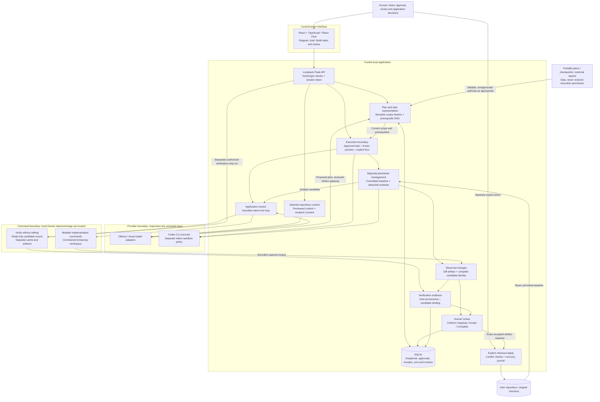

# PlanBranch architecture and trust boundaries

This diagram describes the current source architecture, reviewed on 26 October
2026. Arrows show data or control flow; each consequential action still has its own
server-side checks. A diagram edge is not an authorization grant.

The human creates any subsequent Git commit using existing Git tools. There is no
PlanBranch edge for automatic commit, merge or push.

## Component map

| Area | Principal implementation |
| --- | --- |
| Interface and interactions | [`App.tsx`](../../frontend/src/App.tsx), [`PlanningPanel.tsx`](../../frontend/src/PlanningPanel.tsx), [`BuildView.tsx`](../../frontend/src/BuildView.tsx), [`ExecutionDialog.tsx`](../../frontend/src/ExecutionDialog.tsx), [`TracePanel.tsx`](../../frontend/src/TracePanel.tsx) |
| API and persistence | [`app.py`](../../flowdesk/app.py), [`storage.py`](../../flowdesk/storage.py), [`migrations/`](../../flowdesk/migrations/__init__.py) |
| Meaning and readiness | [`validation.py`](../../flowdesk/validation.py), [`semantic_intent.py`](../../flowdesk/semantic_intent.py), [`prerequisites.py`](../../flowdesk/prerequisites.py) |
| Model/provider interaction | [`providers.py`](../../flowdesk/providers.py), [`provider_protocols.py`](../../flowdesk/provider_protocols.py), [`repository_context.py`](../../flowdesk/repository_context.py), [`model_executor.py`](../../flowdesk/model_executor.py), [`codex_executor.py`](../../flowdesk/codex_executor.py) |
| Execution, source and evidence | [`execution.py`](../../flowdesk/execution.py), [`execution_git.py`](../../flowdesk/execution_git.py), [`workspace_tools.py`](../../flowdesk/workspace_tools.py), [`command_runner.py`](../../flowdesk/command_runner.py), [`check_evidence.py`](../../flowdesk/check_evidence.py), [`traceability.py`](../../flowdesk/traceability.py) |
| Recovery and portability | [`plan_branches.py`](../../flowdesk/plan_branches.py), [`task_handoff.py`](../../flowdesk/task_handoff.py), [`exports.py`](../../flowdesk/exports.py), [`proposal_drafts.py`](../../flowdesk/proposal_drafts.py) |

## Trust boundaries and assumptions

1. **Browser to local server.** The server is intended for loopback use. Trusted
   hosts, same-origin checks and an application token protect local APIs from
   unrelated web pages. This is not a multi-user network service with account-based
   authorization. The local user and host are trusted.
2. **Intent to authority.** Saving or importing a plan does not approve it. Approval
   does not execute it. Run requires a current reviewed preview and selected
   repository. Restoring a plan increments an epoch and revokes old authority.
3. **Provider to tools.** Model output is validated data. The host owns the bounded
   tool dispatcher, file-path/hash checks and journal. Planning repository access,
   source transmission consent and execution selection are separate decisions.
4. **Worktree to command runtime.** A detached worktree protects the original
   checkout from candidate edits. Native command isolation is a different boundary
   supplied by Docker; Codex uses its own executor policy. No Docker runtime means
   no native command fallback on the host. The Docker daemon/image and native
   sandbox must be trusted and tested on the actual platform.
5. **Report to evidence.** Provider prose, imported reports, observed writable
   commands and immutable verification are distinct categories. Host evidence is
   sealed and bound to its run/candidate. A seal establishes local ingestion
   provenance, not independent truth about a test's adequacy.
6. **Candidate to checkout.** Accept, Complete and Apply are separate operations.
   Applying checks conflicts and uses a durable journal for partial-write recovery.
   Filesystem effects and SQLite cannot form one atomic transaction, so uncertain
   operations retain recoverable request identities rather than being replayed as
   new work.

The source-identity hash covers materialized bytes and executable bits, not the
entire machine, environment or natural-language intent. The current requirement
model is paragraph-level. These boundaries limit specific failure modes; they are
not a proof of overall safety or model correctness. See
[technical discussion](TECHNICAL_CASE_STUDY.md) and
[current evidence](EVIDENCE_REGISTER.md).
