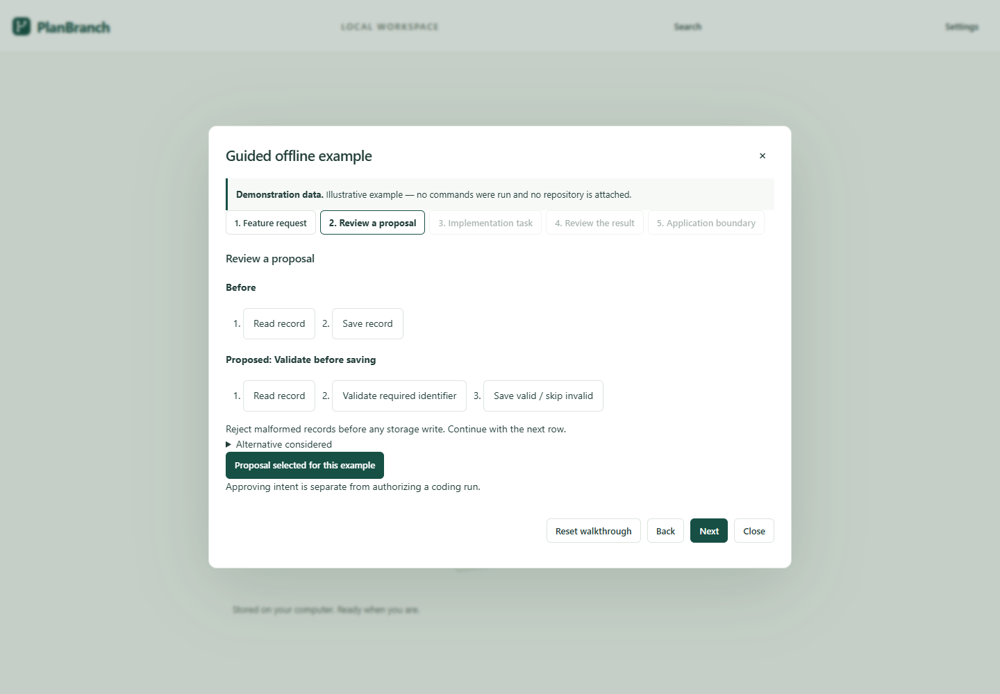
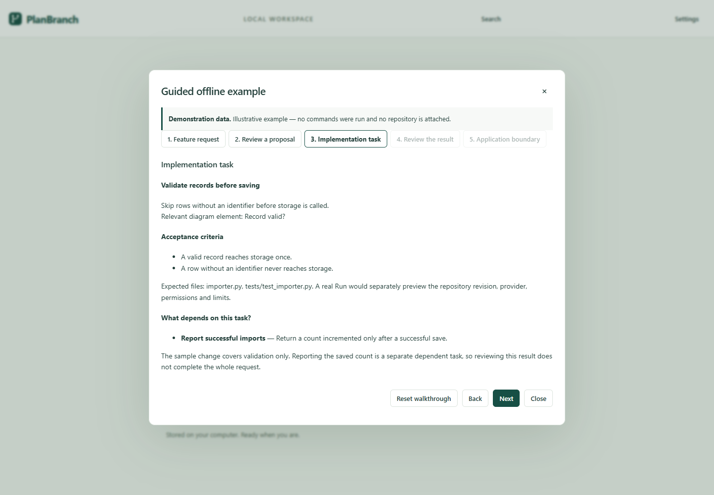
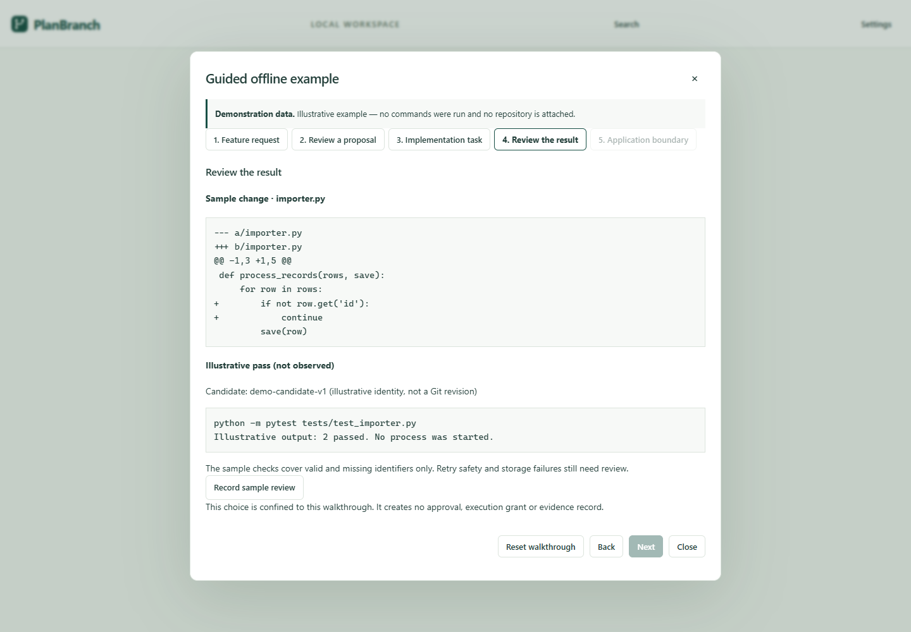
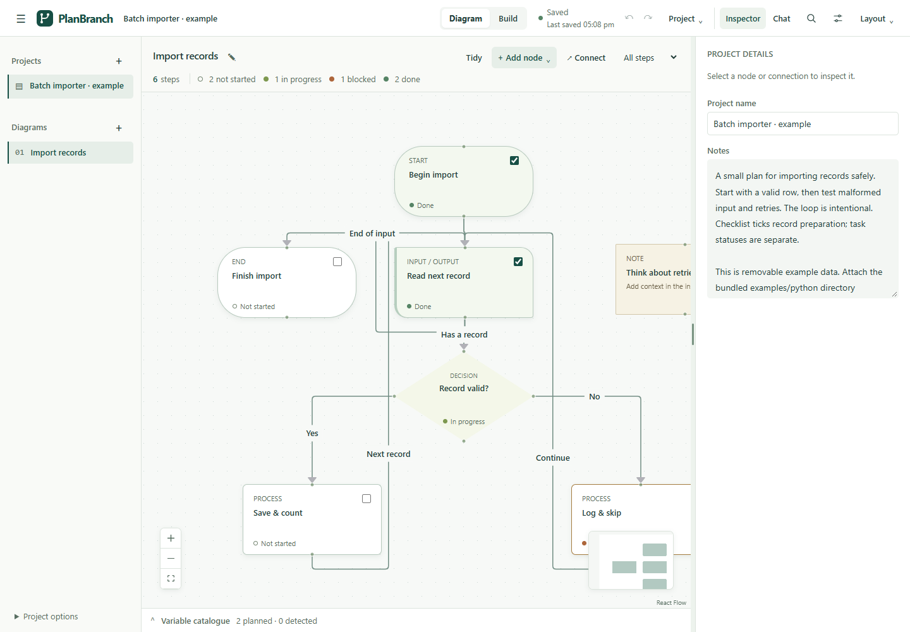

# A 115-second demonstration

**Message:** “PlanBranch keeps intended work, permission to run, observed changes,
tests and the decision to apply separate. These controls are implemented; whether
they improve real coding outcomes remains a research question.”

This script combines a genuine offline application walkthrough with a real local
fixture run. The walkthrough's code and check output are **illustrative**. The
fixture's Git operations, checks and boundary observations are **actual**, while
its candidate edits and review actions are scripted. Neither is a real AI run or
a measured human-review trial.

## Prepare once

1. Use the [source or packaged installation](../../README.md). For source, build
   the frontend before opening the app. Do not open a personal project for this
   demonstration. Start with a fresh disposable data directory, for example:

   ```powershell
   $demoData = Join-Path $env:TEMP ("planbranch-demo-" + [guid]::NewGuid())
   .\.venv\Scripts\python.exe -m flowdesk --data-dir $demoData --port 4312
   ```

2. Open `http://127.0.0.1:4312`. Choose **Guided offline example**. It needs no
   model connection, credential, repository attachment or runtime grant.
3. In a second terminal run the deterministic evaluation and keep its output:

   ```powershell
   .\.venv\Scripts\python.exe scripts/portfolio_evaluation.py --output output/portfolio-evaluation.json
   ```

   This creates and removes its own temporary repositories and app data. It never
   accepts an existing repository path. It uses only the fixed bundled executor
   and independent oracle. Allow the run to finish before recording, or show it
   running honestly without claiming a fixed completion time.
4. Open the output JSON beside the app. For the matching portable visual plan,
   use Project's JSON import with
   [importer.planbranch.json](../../examples/evaluation/importer.planbranch.json).
   Import creates ordinary project content, not approval or execution authority.
   The built-in walkthrough and this plan share the importer motivation; the
   fixture plan spells out its narrower dictionary-row assumptions.

## Recording script

| Time | Screen action | Suggested narration |
| --- | --- | --- |
| 0–12 s | Show the welcome screen and open Guided offline example. | “With a coding agent, a proposed change, a successful process and verified completion can look similar. This workspace keeps them distinct.” |
| 12–28 s | Show the requirement and select the validation-first design. | “The goal is to validate records before saving. The design decision is to keep validation before storage, and count successful writes in a separate step.” |
| 28–42 s | Show the first task's criteria and the dependent counting task; open the example diagram if useful. | “The diagram explains intended behavior. Build tasks have separate prerequisites. Completing validation must precede counting; a flow arrow alone does not grant permission to run.” |
| 42–55 s | Show the illustrative diff and its explicit demonstration label. | “This offline diff is illustrative. No AI or command ran in this walkthrough. Opening the example creates no repository attachment or approval.” |
| 55–72 s | Switch to the completed terminal run, then the importer record in the JSON receipt. | “Here a deterministic fixture did run the real workflow services in a disposable Git repository. Three independent checks passed. Approval alone was insufficient to execute, and execution did not accept, complete or apply the change.” |
| 72–88 s | Show pagination's `unrequestedFiles` and recovery's failed R3 check. | “Passing functional tests did not justify this unrelated settings change. The interrupted export preserved partial work but still failed its non-finite-number requirement. These are deliberately constructed test cases.” |
| 88–105 s | State a decision to withhold acceptance of the pagination candidate. Return to the walkthrough and use **Record sample review** only for its labelled illustrative example. | “I would withhold acceptance until the unrelated edit is removed and missing checks pass. PlanBranch leaves acceptance and application explicit. The harness's accept/apply action was scripted only in its disposable checkout; it is not evidence of a human study.” |
| 105–115 s | Show the evaluation's first paragraph. | “The next question is whether this helps real reviewers. The comparison protocol is ready; empirical AI and human trials have not yet been conducted.” |

If presenting the exported fixture plan instead of the walkthrough, inspect its
brief, two Build tasks and dependency first. Its “not approved” state is part of
the demonstration. Do not attach a real repository to make a button look enabled.

## Screenshots from the implemented application

These are genuine browser captures with disposable data. They show the offline
walkthrough, not a model interaction or authenticated execution result.









Regenerate with `node --test scripts/capture_portfolio.cjs` after the frontend
build. The capture uses the repository's disposable browser-test harness. The
[evidence register](EVIDENCE_REGISTER.md) records the actual validation status.

## Review and recovery details to demonstrate if asked

- **Approval is insufficient:** the fixture first approves the plan and observes
  that execution is still blocked until a repository is separately authorized.
- **Prerequisites are meaningful:** the importer counting task is blocked before
  validation completes and still needs the applied prerequisite in committed
  source before a dependent run can start. The fixture does not make that commit.
- **Source remains intact:** checks compare the original checkout before review;
  separate acceptance and completion calls still leave it unchanged. Explicit
  Apply changes only the disposable checkout and neither stages nor commits.
- **Failure remains visible:** the JSON exporter keeps its captured candidate
  after service reopen; the missing R3 check remains failed. The interruption is
  injected, not a claimed power-loss or OS-crash experiment.
- **A review is a judgment:** the presenter makes a stated decision based on the
  displayed diff and criteria. That decision is not an automatic correctness
  guarantee, and one presentation is not evidence of improved human performance.

## Recording checklist

- Show the application, fixture label, task, dependency, diff, criteria and review
  decision at readable scale; preserve the demonstration and provenance labels.
- Keep only disposable project names and relative source paths on screen. Hide
  unrelated browser tabs, terminal history, local paths and provider settings.
- Record the exact checkout and fixture receipt used; do not splice illustrative
  output into a real execution record.
- State “scripted candidate” and “external independent checks”; do not call these
  model results or PlanBranch's immutable verification runtime.
- After recording, stop the demo server. Its disposable data may be removed only
  after verifying the exact created directory; do not remove the normal app data.
- No recording is claimed here. The repository contains reproducible instructions
  and genuine screenshots; a narrated video remains an owner recording task.
